<picture>
  <source media="(prefers-color-scheme: dark)" srcset="assets/header-dark.svg">
  
</picture>

I’m a full stack developer at **DKMECO Malaysia**, working directly with clients on CRM, help desk, e-signature and voice AI projects. I run discovery and demos, build the integrations, internal apps and tests, then train teams and hand the work over.

My portfolio is at **[cheepheng.github.io](https://cheepheng.github.io)**. It includes a [website showcase](https://cheepheng.github.io/#/showcase): a library of sites I’ve built that you can open and use live.

## Client work at DKMECO Malaysia

*Full Stack Developer (Client Facing), May 2026 to now, remote*

&nbsp; **Zendesk to Intercom Fin migration for Toys“R”Us Asia.** A Node.js tool, using Zendesk OAuth, for the ongoing move of customer records and ticket history to Intercom Fin. I verified the message text on all 73 pilot tickets, and checked timestamps, field mappings and attachments.

&nbsp; **Two-way HubSpot and monday.com sync, with a Deal Cockpit.** Deals, contacts and companies stay in sync across three monday.com boards through Cloudflare Workers, with duplicate prevention, retries and daily reconciliation, all covered by 500+ automated tests. The embedded React Deal Cockpit adds KPI and Kanban views, live HubSpot search, and editing for deal associations and line items.

&nbsp; **Japanese-language voice AI for Jackery.** A proof of concept with ElevenLabs and Zendesk Talk that answers from the knowledge base, looks up orders and returns, and transfers calls to an agent over SIP with the Zendesk ticket’s context.

&nbsp; **Intercom Fin on Telegram and Lark.** Two-way handoff between the bot and support agents, plus demos of database-backed email replies and booking.

**DocuSign IAM Bootcamp, course 2.** I created the training deck and built the vendor onboarding demo with Workflow Builder, Agreement Desk and Agreement Manager, following one workflow from request intake to eSignature and agreement management.

## Before that, at PGL Vision

*Full Stack Developer, June 2025 to April 2026, Kuantan, Pahang*

&nbsp; I built two internal React and TypeScript apps that replaced paper records with same-day production and maintenance reporting:

- **Field production and crew time log**, with offline data entry, role-based access, validation, and PDF and CSV exports for operations and payroll.
- **Equipment inspection and maintenance**, a multilingual app for pre-start checklists and photo records of defects, with downtime tracking, maintenance schedules and fleet dashboards.

## Things I build in my own time

- **[AI Interview Copilot](https://github.com/CheePheng/CoPilot)**: a desktop app that transcribes speech, spots interview questions and suggests answers in an overlay, using local or cloud AI. Electron, React, TypeScript, Ollama, Claude API
- **[KinshipPro](https://kinshippro.vercel.app/)**: an installable Chinese kinship calculator with an offline database of 200+ terms, voice input and text-to-speech. [Code on GitHub](https://github.com/CheePheng/KinshipPro). React, TypeScript, PWA
- **[PartyAI](https://github.com/CheePheng/PartyAI)**: 10+ pass-and-play party games with AI-generated prompts, private turns, scoring and accessibility settings. React, TypeScript, Gemini API
- **[AdCopyGen](https://github.com/CheePheng/AdCopyGen)**: ad copy in eight formats and eight tones, with structured JSON output, retry handling and saved favourites. Next.js, TypeScript, Groq API
- **[Huang Furniture](https://cheepheng.github.io/huang-furniture/)**: a responsive website for a luxury furniture shop, in Chinese and English. HTML, CSS, JavaScript
- **[Website showcase](https://cheepheng.github.io/#/showcase)**: motion-design websites I’ve built, running live inside my portfolio with desktop, tablet and phone views. React, Tailwind CSS, Motion

## Skills

<picture>
  <source media="(prefers-color-scheme: dark)" srcset="assets/skills-dark.svg">
  
</picture>

| Area | What I use |
| --- | --- |
| Programming languages | TypeScript, JavaScript, Java, Python, C#, SQL, PHP, C++, Bash |
| Frontend | React, Next.js, Astro, Vite, Tailwind CSS, shadcn/ui, Motion, Zustand, Electron, Ionic, PWAs |
| Backend and APIs | Node.js, Spring Boot, .NET MVC, Java RMI, REST, GraphQL, webhooks, OAuth 2.0, WebAuthn passkeys, microservices |
| Data | PostgreSQL, MySQL, MongoDB, Supabase, Cloudflare D1 and KV |
| Cloud and delivery | Cloudflare Workers, AWS, Azure, Docker, Linux, GitHub Actions, CI/CD, Vercel, Maven |
| AI and voice | Claude API, Gemini API, Groq, Ollama, Workers AI, ElevenLabs, SIP, Web Speech API |
| Business platforms | Intercom Fin, Zendesk, HubSpot, monday.com, Salesforce, DocuSign IAM, Telegram and Lark bots |
| Testing | Vitest, JUnit, user acceptance testing, migration validation |
| Languages I speak | English (fluent), Mandarin (lower intermediate), Bahasa Malaysia (basic) |

## Education

**BSc (Honours) in Computing in Cloud Computing**, Dundalk Institute of Technology, Ireland, 2025. First-class marks in the final-year project (74%) and Cloud Architecture (70%).

**BSc in Computing (software development)**, Dundalk Institute of Technology, 2024. Pass with Merit, with first-class marks in Data Analysis for Computing (81%) and the Software Project (71%).

## Get in touch

I’m open to full stack developer, forward deployed engineer, solutions engineer, integration engineer and AI engineer roles, whether remote, hybrid or on-site. Email me at [cheephengcheepheng@outlook.com](mailto:cheephengcheepheng@outlook.com) or connect on [LinkedIn](https://www.linkedin.com/in/chee-pheng-ng-9557351ba/).
